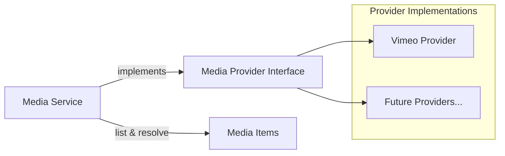
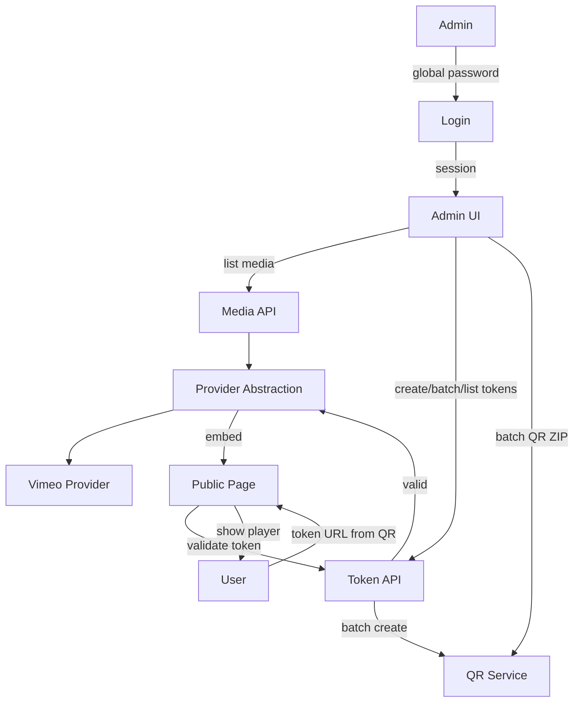

# Media Access Manager - MVP Concept

## Overview

A simplified Nuxt.js webapp for managing token-based access to media from different providers. Admins use a single global password to manage media and generate access tokens (single or batch). Batch tokens can be exported as QR codes in a ZIP for printing. End users access media via token URLs; invalid tokens show a "contact support" message. The app is white-labelable (primary color, logo, company name).

---

## Comparison: Original vs. MVP

| Aspect    | Original Concept                    | MVP                                            |
| --------- | ----------------------------------- | ---------------------------------------------- |
| Auth      | User accounts (email/password)      | Single global password                         |
| Media     | Vimeo only                          | Provider abstraction layer                     |
| Tokens    | Complex (IP, batch QR, etc.)        | Create & batch per media, list tokens          |
| Analytics | Device UUID, TokenUsage, dashboards | View history per token, usage statistics       |
| QR        | Batch generation, ZIP download      | Batch generation, ZIP download (kept)          |
| Theming   | Not specified                       | White-label: primary color, logo, company name |

---

## 1. Media Provider Abstraction Layer

Introduce a **provider interface** so media can come from different sources (Vimeo today, others later).



**oEmbed standard** – Media providers return responses in the [oEmbed format](https://oembed.com/). Use existing libraries (e.g. `oembed-parser`, `@extractus/oembed-extractor`) to fetch, parse, and render oEmbed content.

**Interface contract** (TypeScript-style):

```ts
// oEmbed response types per https://oembed.com/
interface OEmbedBase {
  type: 'photo' | 'video' | 'link' | 'rich'
  version: string
  title?: string
  author_name?: string
  author_url?: string
  provider_name?: string
  provider_url?: string
  cache_age?: number
  thumbnail_url?: string
  thumbnail_width?: number
  thumbnail_height?: number
}

interface OEmbedVideo extends OEmbedBase {
  type: 'video'
  html: string
  width: number
  height: number
}

interface OEmbedPhoto extends OEmbedBase {
  type: 'photo'
  url: string
  width: number
  height: number
}

interface OEmbedLink extends OEmbedBase {
  type: 'link'
}

interface OEmbedRich extends OEmbedBase {
  type: 'rich'
  html: string
  width?: number
  height?: number
}

type OEmbedResponse = OEmbedVideo | OEmbedPhoto | OEmbedLink | OEmbedRich;

interface MediaProvider {
  id: string // e.g. "vimeo"
  listMedia: () => Promise<MediaItem[]>
  getViewableContent: (mediaId: string, providerConfig: unknown) => Promise<OEmbedResponse>
}

interface MediaItem {
  id: string
  title: string
  providerConfig: VimeoConfig | YoutubeConfig | FileserverConfig
}
```

- **Media table**: `id`, `provider_id`, `title`, `provider_config` (JSON), `created_at`
- **Providers**: Start with Vimeo (oEmbed API); add new providers by implementing the interface and returning oEmbed-compliant responses.
- **Non-downloadable**: Use embeds only (oEmbed `html` for video); rely on provider settings to disable downloads where possible.

---

## 2. Token Model (Simplified)

**Token lifetime** (either or both):

- **Date range**: `starts_at`, `expires_at` (nullable)
- **Max usage**: `usage_limit` (nullable), `usage_count`

**Validity start** – chosen per batch when tokens are created:

- **Immediately** (default): the date window is fixed on creation, with an
  optional `expires_at`.
- **On first use**: the token stores a duration in `valid_for` — one unit out
  of hours, days, weeks or months, e.g. `{"months": 2}` — and keeps
  `expires_at` empty. The first view a visitor spends sets
  `expires_at = now + valid_for`; from then on the token behaves like any
  other. Months are calendar months (via `date-fns`): 10.02. plus two months
  is 10.04., and 31.12. plus two months is 28.02., because a day the target
  month lacks falls back to its last one. Both are exclusive — a token never has a fixed expiry date and a
  first-use duration at once. Admin previews do not count as first use. For a
  group token, browsing the list is free, so the first media watched starts it.

**Editing a batch** – name, usage limit and validity can be changed after
creation and apply to every token of the batch. Views already spent are kept.
A new first-use duration is counted from each token's `first_used_at` (set on
any token's first view), so tokens already running are extended or shortened
rather than restarted; tokens not yet opened keep waiting. A fixed expiry date
replaces the expiry of every token alike.
Before saving a change that would expire tokens still valid right now,
overwrite the expiry of tokens already running since their first use, or lower
the usage limit to or below what tokens have already used (for a group token:
on any one of its media), the dialog lists how many are affected and asks the
admin to confirm.

**Editing a single token** – usage limit and validity of one token can be
changed the same way (`PATCH /api/tokens/:id`), with the same rules and the
same confirmation, e.g. to give one visitor more time than the rest of the
batch. When the tokens of a batch no longer share a setting, the batch edit
dialog warns about it and leaves that field empty (for the validity: "Keep each
token's own"). As long as it stays empty, every token keeps its own value;
filling it in applies the new value to every token of the batch again, the
edited ones included. Since an empty usage limit then means "keep", a "Lift the
limit of every token" checkbox removes the limit from all of them.

**Schema** (simplified):

- `tokens`: `id`, `token` (32-char), `media_id`, `batch_id` (nullable FK), `name`, `starts_at`, `expires_at`, `valid_for` (nullable JSON), `first_used_at` (nullable), `usage_limit`, `usage_count`, `created_at`
- `token_views`: `id`, `token_id`, `media_id`, `viewed_at` — one row per spent
  view, see [View history and statistics](#view-history-and-statistics)

**Validation logic**:

- If `starts_at` is set and now < `starts_at` → invalid
- If `expires_at` is set and now > `expires_at` → invalid
- If `usage_limit` is set and `usage_count >= usage_limit` → invalid
- If valid: increment `usage_count` (and set `expires_at` on a first-use token's first view), return embed; if invalid: show "Contact support" message

### Media groups and group tokens

A token points at **either one media or one media group** — never both, never
neither. A group is a named, reusable set of media, so one link (and one
printed QR code) can hand out several videos at once.

A group token's limits are read **per media, not per token**:

- `starts_at` / `expires_at` are shared: the date window either is open or
  closes the whole group at once.
- `usage_limit` is a budget for _each_ media. A visitor who watched one video
  to its limit keeps every other video of the group untouched.

Per-media counts live in `token_media_usage (token_id, media_id, usage_count)`.
Rows appear on first use, so a missing row simply means "not watched yet".
`tokens.usage_count` keeps the total across media for the admin overview only;
nothing is validated against it for a group token.

**Public flow for a group token**:

1. `/{token}` lists the group's media with each one's own remaining access.
   Looking at the list costs nothing.
2. The visitor picks one and lands on `/{token}/{mediaId}`, which spends a view
   on that media alone and renders the player — after the visitor confirmed it,
   when the view is limited or starts the access period.
3. Media the token can no longer open stay on the list, marked as used up
   rather than hidden — the visitor sees what they had and can ask for more.

Because the counts are per media, a partly used-up group is a normal state, not
an error: some entries play, others are closed.

### View history and statistics

Every spent view is written to `token_views (id, token_id, media_id,
viewed_at)` in the same transaction that raises the counter, so the count and
the history behind it cannot drift apart. `media_id` is the media opened: a
single-media token's own, or the one picked from a group. Nothing about the
visitor is recorded — no address, no device, no user agent — only _that_ a
token opened a media and _when_. Admin previews spend nothing and leave no row.

The history answers two questions:

- **Per token** (`GET /api/tokens/:id/views`): when a visitor asks "why are all
  my views gone?", the admin opens the token's history from the token list and
  sees every view with its time and media, next to the token's creation, first
  use and expiry. Views spent before the history existed are in `usage_count`
  but have no row; the dialog says how many, rather than letting the gap look
  like a bug.
- **Across the deployment** (`GET /api/statistics`): the statistics page counts
  the views of a period — the last 7, 30 or 90 days per day, the last 12 months
  per month — as a chart, per media, and as a list of the latest views with the
  token and batch that spent them. The page sends the range as instants plus its
  own IANA time zone, and the server buckets by that zone, so a view at 23:30 in
  Berlin lands on the Berlin day. An optional `mediaId` narrows everything down
  to one media; the media page links here with its own id.

Deleting a media removes the views that point at it (its own tokens' and group
tokens' alike), and lowers each group token's total by the views it spent
there, so a token's count and its history keep agreeing; deleting a group
removes the views of its tokens.

---

## 3. Admin: Single Global Password

- **No users table**; replace with:
  - Single password in config/env (e.g. `NUXT_ADMIN_PASSWORD`)
  - Session/cookie after successful login
- **Admin capabilities**:
  - List media (from all providers)
  - Create and edit media groups (a named set of media)
  - Create tokens per media _or_ per group (single or batch)
  - Batch token generation with QR codes (ZIP download)
  - List tokens per media and per group
  - Edit a batch: name, usage limit and validity of all its tokens
  - Read a token's view history, and the usage statistics of a period
- **Removed**:
  - User CRUD
  - Device tracking and anything else that identifies a visitor

---

## 4. Public Flow: View with Token

**Single-media token**

1. User visits `/{token}` (or similar).
2. Validate token (dates + usage limit).
3. If invalid → show message: "This link is no longer valid. Please contact support."
4. If the view would cost the visitor something — the token has a usage limit,
   or its validity starts on first use and has not started yet — the page only
   shows the media title, the remaining access and what watching now would
   spend (one view; the access period starting, with the date it would end).
   Nothing is spent until the visitor confirms with "Watch now" / "Start access
   now"; reloading the page asks again. Admin previews never spend anything and
   skip the question.
5. If valid and confirmed (or nothing to confirm) → fetch embed via provider,
   increment `usage_count`, record the view in `token_views`, render player.
6. No device tracking: the view is recorded with its time and nothing else.

The confirmation is a `POST` to the same access endpoint the page reads with
`GET`: `GET` never spends a view that needs confirming, so neither an accidental
tap nor a messenger's link preview fetching the URL uses up access.

**Group token**

1. User visits `/{token}` and gets the group's media list, each entry showing
   its own remaining views. Listing spends nothing.
2. User picks one and lands on `/{token}/{mediaId}`.
3. Validate the date window plus _that media's_ count; if it is used up, the
   media is refused while the rest of the group stays open.
4. As for a single-media token, a view that would spend a limited view or start
   the access period is confirmed first.
5. If valid → fetch embed via provider, increment that media's `usage_count`,
   render player, and offer the way back to the list.

---

## 5. White-Label Theming

Theme config, set per deployment through `NUXT_PUBLIC_THEME_*` environment
variables. See [theming.md](./theming.md) for the full reference.

| Setting              | Description                             | Example      |
| -------------------- | --------------------------------------- | ------------ |
| `title`              | Brand name                              | `Acme Media` |
| `logo` / `logoDark`  | Logo URL or path, per color mode        | `/logo.svg`  |
| `favicon`            | Browser tab icon                        | `/icon.svg`  |
| `colors.primary`     | Brand color, or a Tailwind palette name | `#0f4c81`    |
| `colors.neutral`     | Greys for text, surfaces and borders    | `slate`      |
| `radius` / `spacing` | Roundness and density of the whole UI   | `0.5rem`     |
| `container`          | Maximum content width                   | `72rem`      |

Implementation:

- `utils/theme.ts` derives a full 11-shade Tailwind-style palette from a single
  brand color and renders the theme as CSS custom properties
- `plugins/theme.ts` injects them and sets the document title and favicon
- Logo and company name in header/nav via `layouts/default.vue`

---

## 6. Architecture



---

## 7. File Structure

```text
media-access-manager/
├── server/
│   ├── api/
│   │   ├── auth/           # login, logout (global password)
│   │   ├── media/          # list media (from providers)
│   │   ├── groups/         # CRUD media groups
│   │   ├── tokens/         # CRUD tokens, batch create, list by media
│   │   │   ├── batch/      # POST batch, GET batch/:id/qr-zip
│   │   │   └── [id]/views  # a token's view history
│   │   ├── statistics      # views of a period: per day/month, per media, latest
│   │   └── access/         # validate token, return embed
│   ├── services/
│   │   ├── authService.ts
│   │   ├── mediaService.ts
│   │   ├── tokenService.ts
│   │   ├── mediaGroupService.ts
│   │   ├── qrService.ts    # QR generation, batch ZIP
│   │   └── providers/
│   │       ├── types.ts   # MediaProvider interface
│   │       └── vimeo.ts   # Vimeo implementation
├── components/
│   ├── admin/             # AdminLayout, MediaList, TokenList, TokenForm,
│   │                      # BatchTokenGenerator, QRCodeDisplay,
│   │                      # TokenViewHistoryModal, ViewStatisticsChart
│   └── public/
│       └── MediaPlayer.vue # Embed + invalid token message
├── pages/
│   ├── login.vue
│   ├── index.vue          # Media list
│   ├── media/
│   │   └── [id].vue       # Media detail + tokens + batch gen
│   ├── groups/
│   │   ├── index.vue      # Media group list
│   │   └── [id].vue       # Group detail + its media + tokens + batch gen
│   ├── tokens/
│   │   └── batch.vue      # Batch token generation (select media, count, QR ZIP)
│   ├── statistics.vue     # Usage statistics: period filter, chart, per media, latest views
│   └── [token]/
│       ├── index.vue      # Public access: player, or a group's media list
│       └── [mediaId].vue  # Public access to one media of a group
├── utils/theme.ts         # Brand palette + theme CSS variables
└── plugins/theme.ts       # Applies the theme from runtimeConfig
```

---

## 8. Database Schema

| Table               | Columns                                                                                                                                        |
| ------------------- | ---------------------------------------------------------------------------------------------------------------------------------------------- |
| `media`             | id, provider_id, title, provider_config (JSON), created_at                                                                                     |
| `media_groups`      | id, name, created_at                                                                                                                           |
| `media_group_items` | group_id, media_id, position (PK: group_id + media_id)                                                                                         |
| `tokens`            | id, token, media_id (nullable), group_id (nullable), batch_id (nullable FK), name, starts_at, expires_at, usage_limit, usage_count, created_at |
| `batches`           | id, media_id (nullable), group_id (nullable), name, created_at                                                                                 |
| `token_media_usage` | token_id, media_id, usage_count (PK: token_id + media_id)                                                                                      |
| `token_views`       | id, token_id, media_id, viewed_at (indexed by token_id and by viewed_at)                                                                       |

Exactly one of `media_id` and `group_id` is set on `tokens` and on `batches`.

SQLite can only relax a column constraint by rebuilding the table, which means
dropping tables that others point at. `PRAGMA foreign_keys` is ignored inside a
transaction and drizzle wraps every migration in one, so `useDb()` lifts
enforcement around the migration run instead.

---

## 9. Batch Token & QR Code Flow

- **Batch creation**: Admin selects media, sets count (e.g. 50–500), expiration/usage limits; API creates tokens in bulk.
- **Batch tracking**: `batches` table and `batch_id` FK on tokens; when creating a batch, create one batch row, then N token rows with `batch_id` set.
- **QR service**: Generate QR codes with `https://{APP_URL}/{token}`; PNG/SVG; configurable size.
- **ZIP download**: `GET /api/batches/:batchId/qr-zip` returns a ZIP of all QR images for the batch.
- **Flow**: Configure batch → POST creates tokens → Download ZIP of QR codes for printing.

---

## 10. Removed Items (from original concept)

- Users table and user management
- Device UUID tracking and `useDeviceTracking`
- IP restrictions on tokens
- Anything in the view history that identifies a visitor (the history keeps
  only token, media and time — see section 2)

---

## 11. Implementation Order

1. **Provider interface + Vimeo provider** – Define interface, implement Vimeo, seed/media list
2. **Schema + token service** – Media + tokens tables, token validation (dates + usage)
3. **Global admin auth** – Single password, simple session
4. **QR service** – QR generation (URL → PNG/SVG), batch ZIP
5. **Admin UI** – Media list, media detail, token create/list, batch generator + QR ZIP download
6. **Public access page** – Token validation, embed, or an expiry notice with a
   mail link to `NUXT_PUBLIC_SUPPORT_EMAIL` for requesting further access
7. **White-label theming** – Primary color, logo, company name via CSS vars and layout

---

## 12. Environment Variables

```env
# Admin
NUXT_ADMIN_PASSWORD=...           # Hashed or plain (bcrypt recommended)

# Media providers (Vimeo)
VIMEO_API_TOKEN=...
ENCRYPTION_KEY=...           # For Vimeo passwords

# Support contact offered on an expired access link (optional)
NUXT_PUBLIC_SUPPORT_EMAIL=support@acme.example

# Publisher of the media, linked in header and footer
NUXT_PUBLIC_PUBLISHER_NAME=Acme GmbH
NUXT_PUBLIC_PUBLISHER_URL=https://acme.example

# Footer credit, defaults to the upstream project
NUXT_PUBLIC_POWERED_BY_NAME=Acme Studio
NUXT_PUBLIC_POWERED_BY_URL=https://studio.example

# White-label (see theming.md for the full list)
NUXT_PUBLIC_THEME_TITLE=Acme Media
NUXT_PUBLIC_THEME_LOGO=/logo.svg
NUXT_PUBLIC_THEME_COLORS_PRIMARY=#0f4c81

# App
APP_URL=https://...
DATABASE_URL=...
```

---

## Summary

The MVP keeps: media list with provider abstraction, tokens per media (single + batch) with date/usage limits, batch QR generation (ZIP download), embed-only viewing, single admin password, white-label theming, and a view history per token with usage statistics. It drops: user accounts, device tracking, and IP restrictions.
