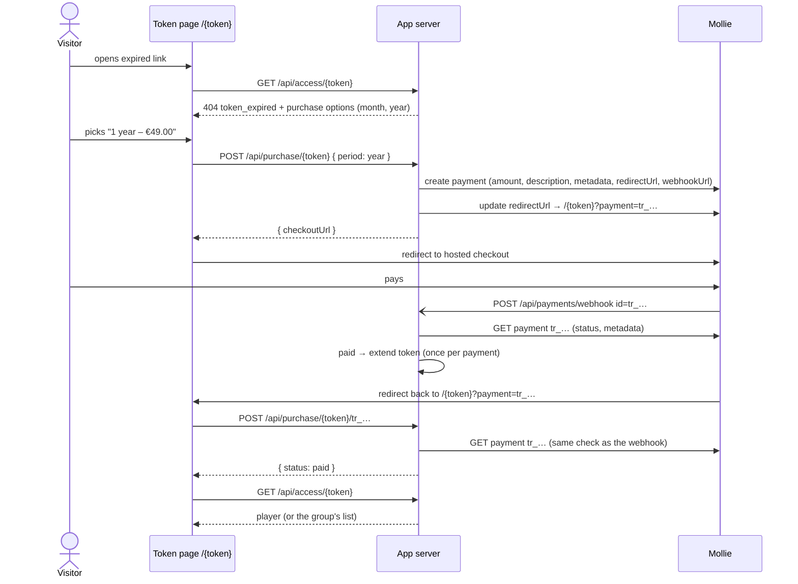

# Buying Access Again (Mollie)

A visitor whose access link has run out can buy it again for **one month** or
**one year**, right on the page that tells them their access ended. The price
is set per media and per group. Payments run through [Mollie](https://www.mollie.com/).

The one rule everything else follows: **this app stores no payment and no
personal data.** Mollie is where the payment lives. The token is the only
reference between the two systems.

---

## 1. What the visitor sees



- **Where purchase is offered**
  - The "your access has ended" page of a single-media or group token, when the
    token ran out by date _or_ by used-up views (`token_expired`).
  - The list of a group token whose date window is still open but some media
    are used up — the same place that already says "some of these can no
    longer be opened".
  - A blocked media page of a group token (`/{token}/{mediaId}`).
- **Not offered** for an unknown link or one that has not started yet. Whoever
  holds such a link was never given access, so there is nothing to renew.
- **Only the options that have a price are shown.** Neither price set, or
  Mollie not configured, means no purchase at all — the page stays as it is
  today, with the support mail link.
- The support mail link stays next to the purchase buttons as the fallback.
- **Admins** opening an expired link keep seeing the way to their media or
  group, not a checkout.

### Returning from Mollie

Mollie's redirect carries no payment id, so the id is put into the redirect
URL itself: the payment is created first, then its `redirectUrl` is updated to
`/{token}?payment=tr_…`. The token page confirms that payment before it loads
anything else:

| Payment status                  | Page shows                                                     |
| ------------------------------- | -------------------------------------------------------------- |
| `paid`                          | the content right away                                         |
| `open`, `pending`, `authorized` | "payment is being processed", checking again every few seconds |
| `canceled`, `expired`, `failed` | "payment was not completed" above the purchase options again   |

If the update of the `redirectUrl` fails, the visitor comes back without the
id. The webhook still extends the token, and the page they return to simply
shows it as valid once that has happened.

---

## 2. What a purchase does to the token

A purchase **extends the token the visitor already holds**. No new link, no
new QR code — the one on their printout keeps working.

- `expires_at` ← `max(now, expires_at) + 1 month | 1 year` (calendar month or
  year; 31 January + 1 month is the end of February).
  - Buying before the old window ended adds on top of it, so nobody loses days
    by paying early.
- `usage_limit` ← `null`. What was bought is time — "one month of access" —
  and a view limit left in place would close that month early. Group tokens'
  per-media counts therefore stop mattering too; they are kept, not reset,
  because they record views that really happened.
- `starts_at`, `name`, `batch_id` stay as they are.

The token is a single row that a batch owns, so extending one visitor's token
never touches the others of that batch.

---

## 3. Privacy: what is stored where

| Data                              | This app                    | Mollie                         |
| --------------------------------- | --------------------------- | ------------------------------ |
| Name, e-mail, IBAN, card, address | never                       | as far as the payment needs it |
| Amount paid                       | never (only the price list) | yes                            |
| Mollie payment id (`tr_…`)        | yes, once paid              | yes                            |
| Token value, media/group id       | yes (already)               | in the payment's `metadata`    |

The app keeps one row per **paid** payment in `token_purchases`:

| Column            | Why                                                                |
| ----------------- | ------------------------------------------------------------------ |
| `payment_id` (PK) | the only thing that stops a repeated webhook extending twice       |
| `token_id`        | which token was extended                                           |
| `period`          | `month` or `year`                                                  |
| `expires_before`  | the token's end before the purchase, so an extension can be undone |
| `expires_after`   | and after it                                                       |
| `created_at`      | when                                                               |

A payment id is an opaque reference. It says nothing about who paid; only
someone with the Mollie account can look behind it, and that is where the data
belongs anyway. Nothing is written for payments that were started but never
paid — Mollie keeps those on its own.

### What goes to Mollie

- **`description`** — shown to the customer on the checkout page and, as far as
  the payment method allows, on their bank statement:
  `"{media title | group name} – 1 year access"`, in the visitor's language.
  Truncated to Mollie's 255 characters.
- **`metadata`** — visible in the Mollie dashboard, for internal analysis:

  ```json
  {
    "token": "3f9a…",
    "tokenId": "a1b2…",
    "target": "group",
    "targetId": "c3d4…",
    "period": "year",
    "adminUrl": "https://media.example/groups/c3d4…"
  }
  ```

  `adminUrl` leads straight from a payment to the group or media in the admin
  UI, and `token` can be pasted into its token filter.

- **`locale`** — the visitor's language, so Mollie's checkout matches the page.

---

## 4. Trust and security

- **The webhook is only a nudge.** Mollie posts nothing but `id=tr_…`; the app
  then fetches that payment with its own API key. A forged call can at most
  make the app look up a payment that is real.
- **The payment decides, not the request.** Token, period and amount are all
  read back from Mollie. The payment's `metadata.tokenId` must match the token
  it is applied to, and the return page additionally checks that it matches the
  token in its URL.
- **Once per payment.** Inserting the `token_purchases` row and extending the
  token happen in one transaction; the primary key on `payment_id` turns a
  second webhook (Mollie retries) or a webhook racing the return page into a
  no-op.
- **Prices are the server's.** The client only names a period; the amount comes
  from the media/group row at the time the payment is created.
- The webhook always answers `200`, also for unknown ids, so it tells a prober
  nothing.
- The purchase endpoints live under `/api/purchase/`, which joins
  `/api/access/` and `/api/payments/webhook` on the list of public paths. They
  are not nested under `/api/access/:token/` because Nitro's typed routes would
  then merge them with `/api/access/:token/:mediaId` and lose its response type.

---

## 5. Configuration

### Environment

```env
# Mollie API key: test_… or live_…. Empty disables purchasing entirely.
NUXT_MOLLIE_API_KEY=

# Currency of all prices (ISO 4217). Defaults to EUR.
NUXT_PUBLIC_PAYMENT_CURRENCY=EUR
```

Redirect and webhook URLs are built from the request's origin (honouring
`X-Forwarded-Host`/`-Proto`), as the QR export already does. On `localhost` no
webhook URL is sent, since Mollie cannot reach it; the return page confirms the
payment instead, so local testing with a `test_` key still works end to end.

### Prices

Media and groups each get two optional prices, stored in the currency's minor
unit (cents) so no rounding ever happens in the database:

| Table          | New columns                                         |
| -------------- | --------------------------------------------------- |
| `media`        | `price_month` (int, null), `price_year` (int, null) |
| `media_groups` | `price_month` (int, null), `price_year` (int, null) |

The admin sets them in a "Purchase" card on the media page and on the group
page. The card says so when Mollie is not configured, so an admin is not left
wondering why visitors see no purchase buttons.

A single-media token takes its media's prices, a group token its group's —
never a sum of the group's media.

---

## 6. Endpoints

| Method  | Path                              | Auth   | Purpose                                         |
| ------- | --------------------------------- | ------ | ----------------------------------------------- |
| `GET`   | `/api/access/:token`              | public | now also returns `purchaseOptions` when expired |
| `GET`   | `/api/access/:token/:mediaId`     | public | the same for a blocked media of a group         |
| `POST`  | `/api/purchase/:token`            | public | `{ period, locale }` → `{ checkoutUrl }`        |
| `POST`  | `/api/purchase/:token/:paymentId` | public | confirms (and applies) a payment → `{ status }` |
| `POST`  | `/api/payments/webhook`           | public | Mollie status updates                           |
| `PATCH` | `/api/media/:id`                  | admin  | `{ priceMonth, priceYear }`                     |
| `PATCH` | `/api/groups/:id`                 | admin  | now also accepts `priceMonth`, `priceYear`      |
| `GET`   | `/api/payments/settings`          | admin  | `{ enabled }` for the admin hint                |

`purchaseOptions` is `[{ period: 'month' | 'year', amount: 900, currency: 'EUR' }]`
with `amount` in minor units; the page formats it with `Intl.NumberFormat`.

---

## 7. Files

```text
server/
├── api/
│   ├── purchase/[token].post.ts
│   ├── purchase/[token]/[paymentId].post.ts
│   ├── media/[id].patch.ts
│   └── payments/
│       ├── settings.get.ts
│       └── webhook.post.ts
├── services/paymentService.ts   # create + confirm payments, apply them
└── utils/
    ├── mollieApi.ts             # the three Mollie REST calls, over $fetch
    ├── priceInput.ts            # validates admin price updates
    └── purchase.ts              # pure rules: options, extension, metadata
utils/money.ts                   # minor units ⇄ Mollie amount string / input
components/
├── PublicPurchaseOptions.vue    # buttons on the expired page and group list
└── PurchasePricesCard.vue       # admin price editor, media + group page
composables/usePaymentReturn.ts  # ?payment= handling on the token page
e2e/support/mollieStub.ts        # local Mollie stand-in for the E2E suite
```

Mollie's official SDK was tried first and dropped: it only accepts an
`https:` endpoint, which rules out the local stand-in the E2E tests run
against, and it brings a legacy HTTP client for what are three plain REST
calls. `NUXT_MOLLIE_API_ENDPOINT` points the app at the stand-in; production
leaves it empty.

---

## 8. Self-review of this concept

Weighed before implementing; the decisions above already reflect the outcome.

**Does "no payment data" hold?** Mostly by construction: nothing from the
payer ever reaches the app, and for abandoned payments nothing is written at
all. The one stored item, the payment id, is unavoidable — without it, Mollie's
retried webhooks would extend a token several times. Alternatives considered:

- _Idempotency via Mollie metadata_ (mark the payment as applied there): a
  read-then-update across the network has no lock, so a retried webhook racing
  the return page could still extend twice, and Mollie restricts which
  payments can be updated at all.
- _Deriving the new expiry deterministically from the payment_ (e.g. "paid at
  - period"): breaks the "buying early adds on top" rule and two purchases in a
    row would overlap instead of adding up.

Keeping the amount out of `token_purchases` costs nothing — revenue reporting
is Mollie's dashboard, reachable from each payment via `adminUrl` in reverse.

**Is the token safe in Mollie's metadata?** The token _is_ the access
credential, so anyone with Mollie dashboard access could watch the media. Those
are the same people who run the app, the `redirectUrl` Mollie stores contains
the token anyway, and it is what makes a payment traceable in the admin UI —
the value was judged worth it, as the request suggested.

**Clearing the usage limit.** The biggest product decision here. A view limit
is sometimes a guard against passing a link around; a paid month without the
limit loosens that guard. But "one month of access" that stops after three
views would be a broken promise to a paying customer, and the date window
already bounds how long a shared link is worth anything. If a limit per paid
period is needed later, it becomes a third price field (`usage_limit_per_period`)
and a reset of the counts, without changing the flow.

**Webhook-only vs. confirming on return.** Webhook-only would be simpler, but
the visitor would land on "your access has ended" until the webhook arrived,
and local development would not work at all. Confirming on return uses the
exact same check, and the transaction makes the two race-free.

**The second Mollie call to put the id into the redirect URL.** Alternatives
were a cookie (lost when a banking app returns the visitor in a different
browser) or waiting for the webhook only (see above). The update is cheap and
failing it degrades to webhook-only instead of breaking.

**Price changes while a payment is open.** The payment keeps the amount it was
created with; the admin's new price applies to the next one. Correct, since
that is what the visitor agreed to on the checkout page.

**Deleting a token, media or group** removes its `token_purchases` rows first,
as it already does with usage counters. A paid payment whose token is gone by
the time the webhook arrives is logged and ignored — the refund is done in
Mollie, where the money is.

**Out of scope for now**, all addable without changing the model: refunds and
chargebacks shortening access again, VAT invoices (Mollie or a separate tool),
showing a token's purchase history in the admin list, and recurring
subscriptions via Mollie mandates (would need a customer id, which is personal
data).
