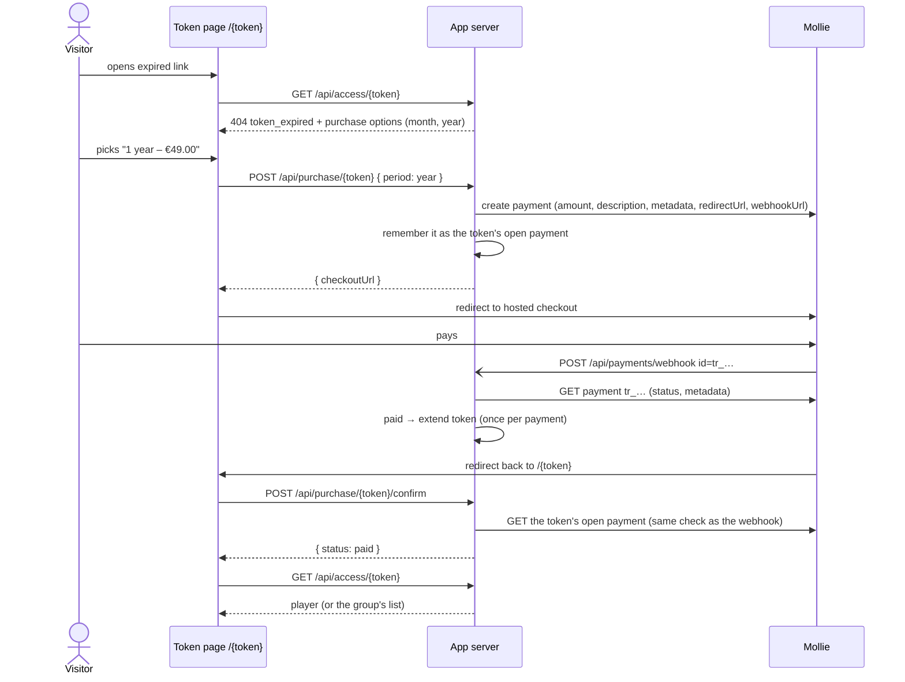

# Buying Access Again (Mollie)

A visitor whose access link has run out can buy it again for **one month** or
**one year**, right on the page that tells them their access ended. The price
is set per media and per group. Payments run through [Mollie](https://www.mollie.com/).

The one rule everything else follows: **this app stores no payment and no
personal data.** Mollie is where the payment lives. The token is the only
reference between the two systems.

---

## 1. What the visitor sees



- **Where purchase is offered**
  - The "your access has ended" page of a single-media or group token, when the
    token ran out by date _or_ by used-up views (`token_expired`).
  - The list of a group token whose date window is still open but some media
    are used up — the same place that already says "some of these can no
    longer be opened".
  - A blocked media page of a group token (`/{token}/{mediaId}`).
- **Not offered** for an unknown link or one that has not started yet. Whoever
  holds such a link was never given access, so there is nothing to renew.
- **Only the options that have a price are shown.** Neither price set, or
  Mollie not configured, means no purchase at all — the page stays as it is
  today, with the support mail link.
- The support mail link stays next to the purchase buttons as the fallback.
- **Admins** opening an expired link keep seeing the way to their media or
  group, not a checkout. While the token has a payment in progress, they also
  get **View payment in Mollie**, the payment in the Mollie dashboard, to
  follow it there.

### Opening the token page, also when returning from Mollie

Mollie's redirect carries no payment id, and needs none: the token remembers
the payment it started (see below), and the `redirectUrl` is just `/{token}`.
Whenever the token page loads — back from the checkout or opened later — it
first asks `POST /api/purchase/{token}/confirm` about the token's open payment
and only then loads the content. Without an open payment that is a database
lookup, no call to Mollie, behind the page's usual loader:

| Payment status                  | Page shows                                                     |
| ------------------------------- | -------------------------------------------------------------- |
| `paid`                          | the content right away                                         |
| `pending`, `authorized`         | "payment is being processed", checking again every few seconds |
| `open` (left without paying)    | "you started a payment" with **Continue payment**              |
| `open` by bank transfer         | "waiting for your bank transfer" with **Show payment details** |
| `canceled`, `expired`, `failed` | "payment was not completed" above the purchase options again   |

Only `pending` and `authorized` hold the page back: Mollie finishes those
within moments. A bank transfer stays `open` for days, and waiting for it on
every visit would only keep the visitor from the page.

Should a payment still be processed after two minutes, the page loads anyway
and says so: it is taking longer than usual, the page need not stay open, and
the link starts working by itself once Mollie confirms the payment. A
**Contact support** mail, with the link filled in, sits right there — a
payment that stays pending is a case for a person, who finds it in the Mollie
dashboard through the token in its metadata.

The wait is for a payment just made. The confirm call answers `wait: false`
for a `pending` payment created more than fifteen minutes ago, and the page
then loads straight away with the same notice: a payment processing for that
long is not going to finish in the next two minutes, and every visit waiting
them out again would only keep the visitor from the page. Not from a second
purchase, though — that stays off until Mollie settles the first.

The visitor is deliberately not sent back to Mollie for a pending payment.
Mollie's API hands out no checkout link for one, and the checkout URL from the
payment's creation opens the method picker again: a visitor who believes the
payment stuck would most likely start a second attempt with another method
while the first is still being processed.

### A payment left open

Mollie keeps a payment `open` after a failed or canceled attempt and sends the
customer back to its checkout to try again; its own "back" link returns them
here with the payment still open
([Mollie: redirect after a failed or canceled attempt](https://docs.mollie.com/docs/handling-payment-status#redirect-back-to-hosted-checkout-page-after-failed-or-canceled-attempt)).
Such a payment is not over: it can still be paid until Mollie lets it expire,
after a time that depends on the method — 15 minutes for iDEAL, six hours for
PayPal, twelve days for a bank transfer
([Mollie: when does a payment expire](https://docs.mollie.com/docs/handling-payment-status#when-does-a-payment-expire)).

So the app does not guess. The token remembers the payment it started until
Mollie reports it `paid`, `expired`, `canceled` or `failed`, and meanwhile:

- the purchase buttons give way to **Continue payment**, which leads to that
  payment's checkout (the one stored at creation, see §3), where the visitor pays, tries another method or leaves
  it to expire. Starting a second payment instead could have them pay twice.
- a bank transfer, `open` until the money arrives, shows "waiting for your
  bank transfer" and **Show payment details**, which is Mollie's page with the
  transfer data.
- where Mollie reports the payment `isCancelable` — a bank transfer is, until
  the money arrives — **Cancel payment and pay another way** cancels it through
  Mollie's API and offers the purchase again, so nobody has to wait twelve
  days for a transfer they changed their mind about. A fresh payment without
  a method is not cancelable, and a payment being processed never is.
- nothing sends the visitor to Mollie unasked: their "back" link would only
  bring them straight back again.

Mollie announces the end through the webhook. Where none gets through — a
local setup, or a webhook lost — the token page asks Mollie about the payment
whenever it loads, so expiry is noticed there as well; and a payment paid
without the visitor coming back is applied the same way.

Beyond the cancelable ones, an open payment cannot be ended on the visitor's
behalf: Mollie's expiry is what ends it.

---

## 2. What a purchase does to the token

A purchase **extends the token the visitor already holds**. No new link, no
new QR code — the one on their printout keeps working.

- `expires_at` ← `now + 1 month | 1 year` (calendar month or year; 31 January
  plus one month is the end of February).
  - Counted from the purchase, never on top of what was left. A token is only
    for sale once it ran out, and the one case where something _is_ left — a
    token whose views ran out before its date — would otherwise turn a
    month's price into unlimited views until that date, years away perhaps.
- `usage_limit` ← `null`. What was bought is time — "one month of access" —
  and a view limit left in place would close that month early. Group tokens'
  per-media counts therefore stop mattering too; they are kept, not reset,
  because they record views that really happened.
- `starts_at`, `name`, `batch_id` stay as they are.

The token is a single row that a batch owns, so extending one visitor's token
never touches the others of that batch.

---

## 3. Privacy: what is stored where

| Data                              | This app                      | Mollie                         |
| --------------------------------- | ----------------------------- | ------------------------------ |
| Name, e-mail, IBAN, card, address | never                         | as far as the payment needs it |
| Amount paid                       | never (only the price list)   | yes                            |
| Mollie payment id (`tr_…`)        | yes, while open and once paid | yes                            |
| Token value, media/group id       | yes (already)                 | in the payment's `metadata`    |

The app keeps one row per **paid** payment in `token_purchases`:

| Column            | Why                                                                |
| ----------------- | ------------------------------------------------------------------ |
| `payment_id` (PK) | the only thing that stops a repeated webhook extending twice       |
| `token_id`        | which token was extended                                           |
| `period`          | `month` or `year`                                                  |
| `expires_before`  | the token's end before the purchase, so an extension can be undone |
| `expires_after`   | and after it                                                       |
| `created_at`      | when                                                               |

While a payment is open, `tokens.open_payment_id` holds its id and
`tokens.open_payment_checkout_url` the checkout Mollie returned when creating
it, so buying again leads back to it. The URL is kept because Mollie's API
stops returning `_links.checkout` once an attempt failed or was canceled,
while the page itself still lets the visitor try again. Both are cleared as
soon as Mollie reports the payment over; one that expired leaves nothing
behind.

A payment id is an opaque reference. It says nothing about who paid; only
someone with the Mollie account can look behind it, and that is where the data
belongs anyway.

### What goes to Mollie

- **`description`** — shown to the customer on the checkout page and, as far as
  the payment method allows, on their bank statement:
  `"{media title | group name} – 1 year access"`, in the visitor's language.
  Truncated to Mollie's 255 characters.
- **`metadata`** — visible in the Mollie dashboard, for internal analysis:

  ```json
  {
    "token": "3f9a…",
    "tokenId": "a1b2…",
    "target": "group",
    "targetId": "c3d4…",
    "period": "year",
    "adminUrl": "https://media.example/groups/c3d4…"
  }
  ```

  `adminUrl` leads straight from a payment to the group or media in the admin
  UI, and `token` can be pasted into its token filter.

- **`locale`** — the visitor's language, so Mollie's checkout matches the page.

---

## 4. Trust and security

- **The webhook is only a nudge.** Mollie posts nothing but `id=tr_…`; the app
  then fetches that payment with its own API key. A forged call can at most
  make the app look up a payment that is real.
- **The payment decides, not the request.** Token, period and amount are all
  read back from Mollie. The payment's `metadata.tokenId` must match the token
  it is applied to. The return page names no payment at all, only the token,
  whose own open payment is looked up.
- **One payment at a time.** While the token's payment is open, starting a
  purchase returns that payment's checkout instead of creating another. Two
  requests arriving together both create one, but only the first to write
  `open_payment_id` (a conditional update) is remembered, and the other
  request is answered with that checkout too; its own payment is shown to
  nobody and expires at Mollie. A late webhook for an older payment only
  clears the open payment if it is that one.
- **Once per payment.** Inserting the `token_purchases` row and extending the
  token happen in one transaction; the primary key on `payment_id` turns a
  second webhook (Mollie retries) or a webhook racing the return page into a
  no-op.
- **Prices are the server's.** The client only names a period; the amount comes
  from the media/group row at the time the payment is created.
- The webhook always answers `200`, also for unknown ids, so it tells a prober
  nothing.
- Mollie is given ten seconds per call. The token page asks about an open
  payment on every load, and a hanging connection to Mollie must not hang the
  page: the page treats the error as "nothing to wait for" and loads.
- The purchase endpoints live under `/api/purchase/`, which joins
  `/api/access/` and `/api/payments/webhook` on the list of public paths. They
  are not nested under `/api/access/:token/` because Nitro's typed routes would
  then merge them with `/api/access/:token/:mediaId` and lose its response type.

---

## 5. Configuration

### Environment

```env
# Mollie API key: test_… or live_…. Empty disables purchasing entirely.
NUXT_MOLLIE_API_KEY=

# Currency of all prices (ISO 4217). Defaults to EUR.
NUXT_PUBLIC_PAYMENT_CURRENCY=EUR
```

Redirect and webhook URLs are built from the request's origin (honouring
`X-Forwarded-Host`/`-Proto`), as the QR export already does. On `localhost` no
webhook URL is sent, since Mollie cannot reach it; the return page confirms the
payment instead, so local testing with a `test_` key still works end to end.

### Prices

Media and groups each get two optional prices, stored in the currency's minor
unit (cents) so no rounding ever happens in the database:

| Table          | New columns                                         |
| -------------- | --------------------------------------------------- |
| `media`        | `price_month` (int, null), `price_year` (int, null) |
| `media_groups` | `price_month` (int, null), `price_year` (int, null) |

The admin sets them in a "Purchase" card on the media page and on the group
page. The card says so when Mollie is not configured, so an admin is not left
wondering why visitors see no purchase buttons.

A single-media token takes its media's prices, a group token its group's —
never a sum of the group's media.

---

## 6. Endpoints

| Method  | Path                           | Auth   | Purpose                                                                                |
| ------- | ------------------------------ | ------ | -------------------------------------------------------------------------------------- |
| `GET`   | `/api/access/:token`           | public | now also returns `purchaseOptions` when expired                                        |
| `GET`   | `/api/access/:token/:mediaId`  | public | the same for a blocked media of a group                                                |
| `POST`  | `/api/purchase/:token`         | public | `{ period, locale }` → `{ checkoutUrl }` (¹)                                           |
| `POST`  | `/api/purchase/:token/confirm` | public | confirms (and applies) the token's open payment → `{ status, wait, dashboardUrl }` (²) |
| `POST`  | `/api/purchase/:token/cancel`  | public | cancels the token's open payment where Mollie allows it; `409` otherwise               |
| `POST`  | `/api/payments/webhook`        | public | Mollie status updates                                                                  |
| `PATCH` | `/api/media/:id`               | admin  | `{ priceMonth, priceYear }`                                                            |
| `PATCH` | `/api/groups/:id`              | admin  | now also accepts `priceMonth`, `priceYear`                                             |
| `GET`   | `/api/payments/settings`       | admin  | `{ enabled }` for the admin hint                                                       |

`purchaseOptions` is `[{ period: 'month' | 'year', amount: 900, currency: 'EUR' }]`
with `amount` in minor units; the page formats it with `Intl.NumberFormat`.
Next to it, `openPayment` is `{ period, status: 'open' | 'pending' | 'transfer', resumable, cancelable }`
while the token has a payment Mollie still holds open, `null` otherwise.

(¹) The checkout of the token's open payment while there is one; `409
payment_in_progress` when that payment is being processed and Mollie has no
checkout left to show.

(²) `wait` says whether the page should hold back: a `pending` payment started
within the last fifteen minutes. `dashboardUrl` is the payment in the Mollie
dashboard, set for a logged-in admin only and `null` for everyone else.

---

## 7. Files

```text
server/
├── api/
│   ├── purchase/[token].post.ts
│   ├── purchase/[token]/confirm.post.ts
│   ├── purchase/[token]/cancel.post.ts
│   ├── media/[id].patch.ts
│   └── payments/
│       ├── settings.get.ts
│       └── webhook.post.ts
├── services/paymentService.ts   # create, confirm, cancel payments; apply them
└── utils/
    ├── mollieApi.ts             # the three Mollie REST calls, over $fetch
    ├── priceInput.ts            # validates admin price updates
    └── purchase.ts              # pure rules: options, extension, metadata
utils/money.ts                   # minor units ⇄ Mollie amount string / input
components/
├── PublicPaymentNotice.vue      # late or failed payment, admin link to Mollie
├── PublicPurchaseOptions.vue    # buttons on the expired page and group list
└── PurchasePricesCard.vue       # admin price editor, media + group page
composables/usePaymentCheck.ts   # settles the token's payment before the page loads
e2e/support/mollieStub.ts        # local Mollie stand-in for the E2E suite
```

Mollie's official SDK was tried first and dropped: it only accepts an
`https:` endpoint, which rules out the local stand-in the E2E tests run
against, and it brings a legacy HTTP client for what are two plain REST
calls. `NUXT_MOLLIE_API_ENDPOINT` points the app at the stand-in; production
leaves it empty. The stand-in's checkout also offers "Bank transfer", which
leaves the payment open and cancelable the way Mollie does.

---

## 8. Self-review of this concept

Weighed before implementing; the decisions above already reflect the outcome.

**Does "no payment data" hold?** Mostly by construction: nothing from the
payer ever reaches the app. The one stored item, the payment id, is
unavoidable — without it, Mollie's retried webhooks would extend a token
several times, and a visitor coming back to an open payment would be offered a
second one. An open payment's id is gone again once Mollie reports it over.
Alternatives considered:

- _Idempotency via Mollie metadata_ (mark the payment as applied there): a
  read-then-update across the network has no lock, so a retried webhook racing
  the return page could still extend twice, and Mollie restricts which
  payments can be updated at all.
- _Deriving the new expiry deterministically from the payment_ (e.g.
  `paid at + period`): close to what is done now, but it would leave nothing
  to put the token back to when the money goes back, and nothing to stop the
  second webhook.

Keeping the amount out of `token_purchases` costs nothing — revenue reporting
is Mollie's dashboard, reachable from each payment via `adminUrl` in reverse.

**Is the token safe in Mollie's metadata?** The token _is_ the access
credential, so anyone with Mollie dashboard access could watch the media. Those
are the same people who run the app, the `redirectUrl` Mollie stores contains
the token anyway, and it is what makes a payment traceable in the admin UI —
the value was judged worth it, as the request suggested.

**Clearing the usage limit.** The biggest product decision here. A view limit
is sometimes a guard against passing a link around; a paid month without the
limit loosens that guard. But "one month of access" that stops after three
views would be a broken promise to a paying customer, and the paid period
bounds how long a shared link is worth anything — which is why the period
counts from the purchase and not from a date the token still had: a
view-limited token valid for years would otherwise sell years of unlimited
views for a month's price. If a limit per paid period is needed later, it
becomes a third price field (`usage_limit_per_period`) and a reset of the
counts, without changing the flow.

**Webhook-only vs. confirming on return.** Webhook-only would be simpler, but
the visitor would land on "your access has ended" until the webhook arrived,
and local development would not work at all. Confirming on return uses the
exact same check, and the transaction makes the two race-free.

**Remembering the open payment on the token.** The alternatives were to
carry the payment id in the return URL — which costs a second Mollie call to
update the `redirectUrl` once the id exists — or a cookie, lost when a banking
app returns the visitor in a different browser. Both are lost on a reload or a
later visit, and the visitor would then be offered a second payment next to
one they can still pay. The token knowing its payment makes the id in the URL
unnecessary: the return page asks about the token's payment, so a crafted URL
cannot point it at any other. Two columns on the token hold it — id and checkout URL — since a token
has at most one payment in progress; it is cleared only for that very payment, so a late webhook of an
older one cannot drop a newer. Asking Mollie on every load of an expired page
costs one API call, and only while a payment is open.

**Price changes while a payment is open.** The payment keeps the amount it was
created with; the admin's new price applies to the next one. Correct, since
that is what the visitor agreed to on the checkout page.

**Deleting a token, media or group** removes its `token_purchases` rows first,
as it already does with usage counters. A paid payment whose token is gone by
the time the webhook arrives is logged and ignored — the refund is done in
Mollie, where the money is.

**Out of scope for now**, all addable without changing the model: refunds and
chargebacks shortening access again, VAT invoices (Mollie or a separate tool),
showing a token's purchase history in the admin list, and recurring
subscriptions via Mollie mandates (would need a customer id, which is personal
data).
